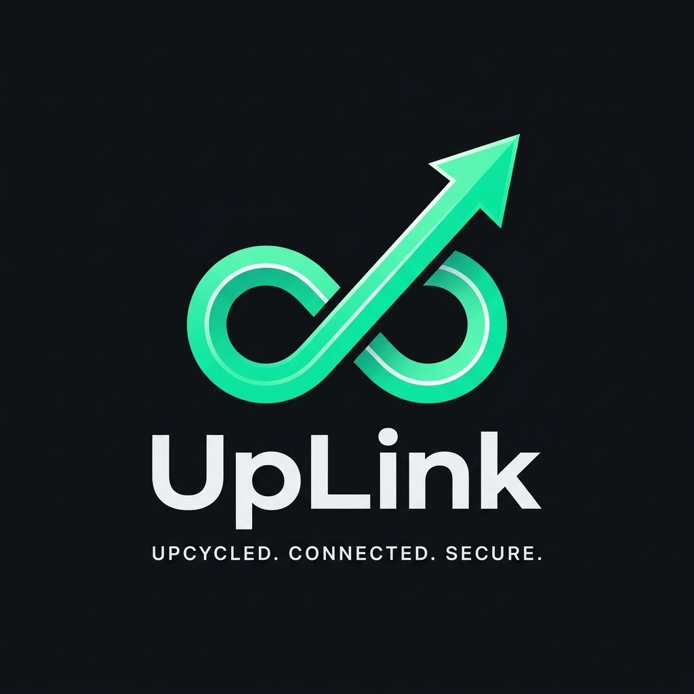

# RePlug™ — The Ethical Upcycling Ecosystem

<div align="center">
  
  <h3>Give Old Tech a New Mission — Upcycled. Connected. Secure.</h3>
  <p>
    <strong>Transform dormant smartphones and tablets into local-first cyber sentinels and automated printer guardians.</strong>
  </p>
  <p>
    <a href="https://umbette.github.io/sentinel/"><strong>🌐 Official Website & Landing Page</strong></a> •
    <a href="#-ecosystem-modules"><strong>📦 Ecosystem Modules</strong></a> •
    <a href="#-quick-start"><strong>🚀 Quick Start</strong></a> •
    <a href="#-ownership-intellectual-property--trademark"><strong>⚖️ Authorship & IP</strong></a>
  </p>
</div>

[](https://github.com/umbette/sentinel/actions/workflows/ci.yml)
[](tests/)
[](#-15-specialized-cyber-defense--privacy-shields)
[](#-zero-knowledge-device-catalog--1-click-unbreak)
[](LICENSE)
[](ha-addon/)
[](Dockerfile)

---

## 🌍 The RePlug™ Cultural Thesis

Over **5 billion functional smartphones and tablets** sit abandoned in drawers across the world. Each houses an ARM multi-core processor, gigabytes of RAM, high-resolution cameras, Wi-Fi/Bluetooth radios, and an internal battery.

Meanwhile, big tech continues selling disposable plastic dongles and proprietary hubs with weak silicon, mandatory cloud subscriptions, and planned obsolescence.

**RePlug rejects this cycle.**  
By giving dormant devices a high-value purpose as local-first appliances, RePlug delivers enterprise-grade domestic security, printer longevity, and ambient automation:
* **Zero New Plastic:** We never require buying new hardware when existing devices can perform the job.
* **100% Local-First:** All processing, threat analysis, and camera inspection runs locally without external cloud telemetry.
* **Anti-Obsolescence:** Silicon manufactured in 2018 is ten times more powerful than contemporary retail IoT gadgets.

---

## 📦 Ecosystem Modules

RePlug is built as a modular architecture where each repurposed device operates as a sovereign sentinel:

### 1. 🛡️ RePlug Sentinel Shield *(Included in this repository)*
Autonomous cyber-defense console, 15 specialized IoT privacy shields, dynamic pricing protection, and zero-knowledge unbreak catalog for local DNS resolvers (**AdGuard Home**, **Pi-hole**) and **Home Assistant**.

### 2. 🖨️ RePlug Nozzle Guardian *(Core Flagship)*
Automated maintenance engine for inkjet (CISS EcoTank) and 3D printers. Connects over the local network via **IPP (Internet Printing Protocol)** to detect inactivity, schedule micro-purges before printhead ink dries out, and uses the device camera for visual nozzle test-pattern and first-layer inspection.

### 3. ⚡ Ambient Sentinels *(Roadmap)*
* **Blackout Beacon:** Detects grid power failure, lights up an emergency path with its flash LED, and sends outage alerts.
* **Acoustic Sentry:** Edge-AI audio classifier listening for smoke detector alarms, glass break sounds, or water leaks.
* **Optical Meter OCR:** Mounts over analog water/gas utility meters to provide daily local consumption readings without smart-meter replacement.

---

## 🌟 15 Specialized Cyber Defense & Privacy Shields

Sentinel Shield operates an array of 15 deterministic, specialized shields engineered to neutralize targeted data exfiltration without breaking usability:

| Shield | Category | Scope & Protection Target |
| :--- | :--- | :--- |
| **🛡️ Anti-Dynamic Pricing** | Travel & Shopping | Blocks 18+ behavioral retargeting networks (Criteo, AppsFlyer, Adjust) to prevent airline/hotel ticket price gouging on repeat searches. |
| **🔐 Crypto & Web3 Vault** | Financial Defense | Whitelist enforcement for official blockchain RPC nodes (`infura.io`, `llamarpc.com`), IDN Punycode homograph unmasking, and wallet-drainer signatures. |
| **👵 Caregiver Anti-Phishing** | Family Protection | Intercepts deceptive delivery (Poste, BRT, DHL) and tax/banking phishing SMS links targeted at elderly relatives, with real-time push alerts. |
| **📺 Smart TV Stealth** | Living Room Privacy | Blocks Automatic Content Recognition (ACR) and audio sampling on Samsung Tizen and LG webOS TVs while keeping Netflix, YouTube, and Prime Video intact. |
| **🧹 Vacuum Camera & LiDAR Guard** | Smart Home IoT | Prevents interior floorplan uploads and camera video exfiltration to offshore clouds on Ecovacs, Roborock, and Dreame vacuums. |
| **🖨️ 3D Printer & Maker IP Guard** | 3D Printing & Makers | Silences cloud diagnostics and telemetry across major 3D printer brands (Bambu Lab, Creality, Anycubic) while preserving full local LAN control (MQTT, OctoPrint/Klipper, local slicing). |
| **🎮 Gaming Console Telemetry Guard** | Gaming Consoles | Local filtering of crash telemetry and diagnostic logs for Nintendo Switch (SysNAND safe), PS5, and Xbox without impacting multiplayer or eShop. |
| **🚗 Automotive Driving Telemetry** | Connected Vehicles | Neutralizes sneaky driving telematics and broker exfiltration (LexisNexis, Verisk, Otonomo) that inflate auto insurance premiums. |
| **🍳 Smart Kitchen & Appliance** | Kitchen Appliances | Silences telemetry, usage habit profiling, and ad SDKs embedded inside smart air fryers (Cosori, VeSync) and kitchen appliances. |
| **📷 Budget IP Camera P2P Isolation** | Security Cameras | Shuts down vulnerable P2P cloud relay channels (`iotcplatform.com`, `p2pcam.net`) on generic cameras while keeping local RTSP open. |
| **🧒 Youth Safeguard** | Child Safety | Blocks predatory videochats (Omegle/OmeTV clones), CSGO skin gambling, and generative AI platforms. |
| **📦 Badbox & Budget AOSP TV C2** | Factory Malware | Cuts Command & Control (C2) beaconing on sub-€150 Android TV boxes infected with Badbox/Peachpit residential proxy botnets. |
| **⚡ Gaming Latency Optimizer** | PC Gaming | Suppresses background launcher telemetries (Steam, Epic Games) that create micro-stutter and network jitter during competitive matches. |
| **🌙 Kids Bedtime Blackout** | Parental Controls | Scheduled evening DNS blackout for TikTok, Instagram, Roblox, and Discord on children's devices. |
| **🍕 Public Venue & Guest Policy** | Retail & Hospitality | Blocks bandwidth-saturating video ads, background cryptomining, and public abuse on guest Wi-Fi while pre-empting POS and food delivery orders. |

---

## 🔓 Zero-Knowledge Device Catalog & 1-Click Unbreak

IoT devices have two distinct traffic streams:
1. **Control Plane (Essential):** Mobile companion app authentication, pairing, cleaning start/stop, status synchronization.
2. **Data Plane (Predatory):** Video uploads, LiDAR maps, driving broker profiling, and ad attribution.

Sentinel solves over-blocking through an open crowdsourced catalog and a 3-tier Zero-Knowledge unbreak system:

```
+─────────────────────────────────────────────────────────────────────────────────+
|                        ZERO-KNOWLEDGE UNBREAK PIPELINE                          |
|                                                                                 |
|  [App Fails to Connect] ➔ [Open Sentinel Dashboard] ➔ [Click: 🔓 Sblocca]       |
|                                         │                                       |
|                                         ▼                                       |
|                  Tier 1: Instant Local 1-Click Self-Resolution                  |
|                  - Injects @@||domain^ into AdGuard Home in < 500ms             |
|                  - Zero bytes egressed to the internet                          |
|                                         │                                       |
|                                         ▼ (Optional)                            |
|                  Tier 2: Zero-Knowledge Community Reporting                     |
|                  - User clicks [ 📢 Condividi Fix ]                             |
|                  - Generates sanitized GitHub issue (NO IP, NO MAC, NO PII)     |
|                                         │                                       |
|                                         ▼                                       |
|                  Tier 3: Crowdsourced Catalog (device_profiles.yaml)            |
|                  - Merged into official repository                              |
|                  - Distributed globally to all Sentinel users via Git/Releases  |
+─────────────────────────────────────────────────────────────────────────────────+
```

* **Open Community Catalog:** Check [`sources/device_profiles.yaml`](sources/device_profiles.yaml) for verified device rules covering Ecovacs, Roborock, Dreame, Bambu Lab, Prusa, Cosori, Shelly, Tuya, Tesla, BMW, and Smart TVs.
* **100% Zero-Tracking Guarantee:** RePlug contains **zero telemetry, zero phone-home pings, and zero analytics**.

---

## 🚗 In-Car Projection & Mobile VPN Compatibility

Using full-tunnel WireGuard or OpenVPN while driving can trigger **Android Auto Communication Error 21** or wireless Apple CarPlay disconnects because local P2P Wi-Fi Direct sockets (`192.168.43.1`) are captured by the VPN routing table.

* Read the complete technical guide and 30-second Split-Tunneling fix in **[docs/MOBILE_AND_AUTO_VPN_GUIDE.md](docs/MOBILE_AND_AUTO_VPN_GUIDE.md)**.

---

## 📊 Real-Time Cyber Defense Console & Scan on Demand

Sentinel includes a responsive, dark-mode web console running at `http://localhost:8087` (and embedded natively in Home Assistant sidebar via Ingress):

* **🔍 Scan on Demand & Network Exposure Audit:** Probes active LAN devices, checks exposed ports (Telnet 23, RTSP 554, HTTP 80/8080) and UPnP mappings, and calculates an overall **Network Health Score (0–100)**.
* **🔔 Zero-Trust Device Admission Control:** Instant push notification when an unknown device connects to the Wi-Fi for the first time with 1-click **[ ✅ Approva ]** or **[ ⛔ Isola ]**.
* **🏆 4-Vector Offenders Analytics:** Breaks down threats across **Brand**, **Device**, **Category**, and **Geography**.
* **Metrics & Unbreak Center:** Live list of top intercepted domains with 1-click unblock buttons.

---

## 🏛️ System Architecture

```
+─────────────────────────────────────────────────────────────────────────────────+
|                                 HOME NETWORK                                    |
|                                                                                 |
|  [📱 Mobile]   [📺 Smart TV]   [🚗 Car App]   [🧹 Vacuum]   [🖨️ 3D Printer]       |
|        │             │               │              │               │           |
|        ▼             ▼               ▼              ▼               ▼           |
|  ┌───────────────────────────────────────────────────────────────────────────┐  |
|  │              LOCAL DNS RESOLVER (ADGUARD HOME / PI-HOLE)                  │  |
|  │  - Static Filter Blocklists (HaGeZi, OISD, Sentinel Community)            │  |
|  │  - 14 Hardware & IoT Shields (140+ targeted user rules)                   │  |
|  │  - Low-latency local cache (< 1.2ms)                                      │  |
|  └─────────────────────────────────────┬─────────────────────────────────────┘  |
|                                        │ Query Stream                           |
|                                        ▼                                        |
|  ┌───────────────────────────────────────────────────────────────────────────┐  |
|  │                         SENTINEL CORE ENGINE                              │  |
|  │  • Contextual Device Resolver (10+ categories)                            │  |
|  │  • Anti-Dynamic Pricing & Travel Protection                               │  |
|  │  • Crypto Vault & Punycode De-obfuscation                                 │  |
|  │  • Multi-Label Shannon Entropy ($H > 3.85$)                               │  |
|  │  • Zero-Knowledge Unbreak Engine (/api/unbreak)                           │  |
|  └───────────────────┬─────────────────────────────────┬─────────────────────┘  |
|                      │                                 │                        |
|                      ▼                                 ▼                        |
|  ┌──────────────────────────────────────┐  ┌─────────────────────────────────┐  |
|  │    HOME ASSISTANT INTEGRATION        │  │     CYBER DEFENSE DASHBOARD     │  |
|  │  - Push alerts on mobile companion   │  │  - Port 8087 / HA Ingress       │  |
|  │  - Interactive 1-click triage        │  │  - 1-Click Unbreak & Stats      │  |
|  └──────────────────────────────────────┘  └─────────────────────────────────┘  |
+─────────────────────────────────────────────────────────────────────────────────+
```

---

## 🚀 Installation & Quick Start

### Option A: Home Assistant Add-on (Recommended)

1. In Home Assistant, navigate to **Settings** ➔ **Add-ons** ➔ **Add-on Store**.
2. Click the three dots (top right) ➔ **Repositories** ➔ Add:
   ```text
   https://github.com/umbette/sentinel
   ```
3. Select **Sentinel Core**, configure your DNS credentials, and click **Start**.

### Option B: Docker Compose (Standalone Server / Proxmox / Unraid)

```bash
git clone https://github.com/umbette/sentinel.git
cd sentinel
cp .env.example .env
cp config.example.yaml config.yaml
docker compose up -d
```

Access the Cyber Defense Console at `http://your-server-ip:8087`.

---

## 🧩 Companion Chrome Extension: Sentinel Shield (MV3)

For endpoint protection when traveling or using public Wi-Fi outside your home network, this repository includes **Sentinel Shield**, an ultra-lightweight Manifest V3 Chrome/Edge extension located in [`extension/`](extension/).

* **Declarative Net Request (DNR):** 0 host permissions required (`action: "block"`).
* **Zero Cloud Telemetry:** Operates 100% offline using a compiled snapshot of the Public Suffix List (8,700+ suffixes) and verified brand heuristics.

---

## 🧪 Test Suite & Verification

The codebase is validated by automated test suites:

```bash
# Run Python backend unit, integration, and Selenium headless e2e tests (89 tests)
PYTHONPATH=. .venv/bin/pytest -v tests/

# Run Manifest V3 sandboxed browser runtime tests (9 tests)
node tests/test_extension_runtime.mjs
```

**Total:** 98 passed (100% pass rate).

---

## ⚖️ Ownership, Intellectual Property & Trademark

* **Original Concept & System Architecture:** Conceived, designed, and authored by **Umberto** (`umbette`) & contributors.
* **Prior Art & Thesis:** Prior art established for the repurposing of consumer mobile devices as autonomous, local-first IoT maintenance agents and privacy sentinels.
* **Trademark:** **RePlug™** and the RePlug Infinity-Ascension logo are trademarks owned by Umberto.
* **Code License:** The software codebase is licensed under the [MIT License](LICENSE).
