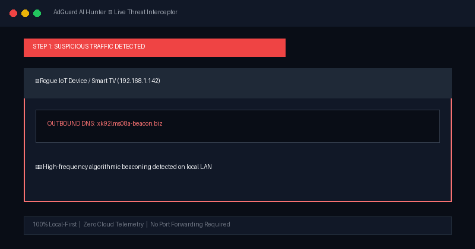
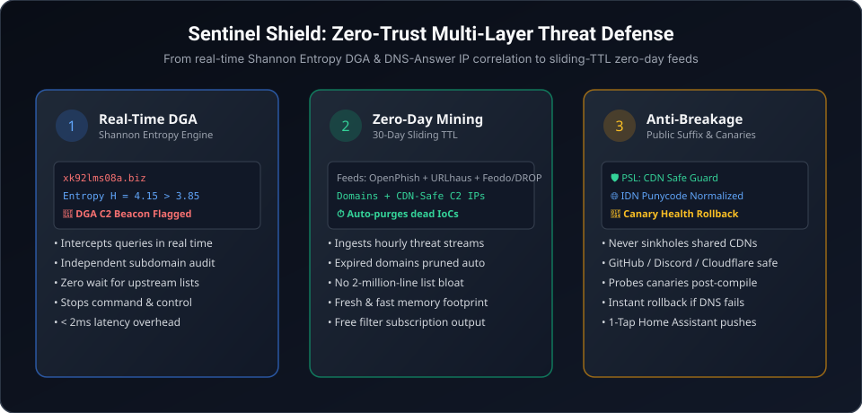

# AI Hunter Daemon

[](https://github.com/umbette/ai-hunter/actions/workflows/ci.yml)
[](LICENSE)
[](https://adguard.com/adguard-home.html)
[](https://ai.google.dev/)
[](Dockerfile)

Autonomous, lightweight, local-first DNS behavioral anomaly detector, DGA hunter, and privacy watchdog designed for **AdGuard Home** and **Home Assistant**.

Monitors DNS traffic in real-time streaming mode, performs multi-label Shannon entropy evaluation ($H > 3.85$) and velocity burst tracking on unseen domains, verifies anomalies with **Gemini Flash**, and dispatches actionable 1-click mobile push alerts via Home Assistant identifying the exact LAN client IP.

<p align="center">
  
</p>

---

## 🛡️ Multi-Layer Threat Architecture (Zero-Trust & Anti-Breakage)

AI Hunter combines real-time streaming heuristics with proactive zero-day ingestion and strict anti-breakage guardrails:

<p align="center">
  
</p>

---

## 💡 How AI Hunter Differs from DNS Blocklists (HaGeZi, RuffKez CTI, OISD, etc.)

> **TL;DR:** AI Hunter is **not a DNS blocklist** and is not meant to replace curated threat feeds like HaGeZi TIF or RuffKez CTI. It is a **local runtime anomaly detector (NIDS layer)** designed to run *alongside* your existing DNS blocklists.

| Feature | Standard DNS Threat Feeds (HaGeZi, RuffKez CTI, OISD) | AI Hunter Daemon |
| :--- | :--- | :--- |
| **Primary Role** | **First line of defense:** Blocks known malicious domains, phishing, scam sites, and tracked C2s. | **Behavioral watchdog:** Catches zero-day algorithmic domains (DGAs) and anomalous device beaconing in real time. |
| **Operation** | Static or hourly compiled lists of known Indicators of Compromise (IoCs). | Real-time streaming evaluation of AdGuard Home live query logs. |
| **Detection Method** | Threat intelligence feeds, OSINT aggregation, honeypots. | Local Shannon entropy ($H > 3.85$), burst analysis, and Gemini Flash contextual verification. |
| **LAN Visibility** | None (AdGuard blocks or allows, but you don't get device triage context). | Identifies the exact internal client IP (e.g. rogue IoT smart plug) and pushes actionable 1-click triage alerts to Home Assistant. |
| **Zero-Day Catch** | Blocked only after the domain is observed, reported, and compiled into the feed. | Immediate — catches high-entropy DGA strings generated by malware beacons before they are indexed anywhere. |

**Recommended Setup:** Keep your favorite blocklists (HaGeZi TIF, RuffKez CTI) active in AdGuard Home. AI Hunter sits quietly on top of them, monitoring traffic that bypasses static lists and alerting you if a specific device on your network starts behaving suspiciously.

---

## Architecture Principles: 100% Local-First & Zero-Trust

1. **Air-Gapped Friendly:** No dynamic remote rule pulls. All configurations, whitelist exceptions, and thresholds are maintained locally in your own `config.yaml` and SQLite database.
2. **Transactional Read-Modify-Write Rule Injection:**
   - AdGuard Home's `/control/filtering/set_rules` API replaces the entire rule set.
   - AI Hunter executes a strict transactional Read-Modify-Write pattern (`GET status` -> inspect/append -> `POST set_rules`) ensuring user custom rules and standard blocklists are never wiped or corrupted.
3. **Zero Inbound Exposed Ports:**
   - Instead of exposing an inbound webhook port, AI Hunter establishes an outbound authenticated WebSocket connection to Home Assistant (`/api/websocket`).
   - Listens for interactive notification actions (`BLOCK_DEVICE`, `BLOCK_GLOBAL`, `IGNORE`).
4. **Multi-Label Shannon Entropy ($H > 3.85$) & Rate Burst Tracker:**
   - Analyzes subdomains and main domain labels independently to catch DGAs hidden in deep subdomains.
   - Tranco Top 10k apex domain bypass to avoid cloud CDN false positives.
   - Sliding-window token-bucket tracking for IoT telemetry beacons.
5. **Cloud Evaluation with Resilient Heuristic Fallback:**
   - Powered by Gemini Flash with Pydantic structured output.
   - If the external API is unreachable or times out, AI Hunter automatically falls back to local heuristic threat metadata without stalling the pipeline.
6. **Decision Persistence & Snooze Management:**
   - SQLite backed in WAL mode (`journal_mode=WAL`) at `/app/data/hunter_decisions.db`.
   - Supports apex wildcard domain matching (`*.domain.com`) and client-specific precedence over global rules.
   - 30-day snooze expiration for false-positive whitelisting with periodic automatic cleanup.
7. **Ultra-Low Resource Footprint:**
   - Bounded Docker container: `cpus: '0.2'`, `memory: 256M`.
   - Idle footprint: `< 20 MiB` RAM and `0.00%` CPU.

---

## Quick Start (Docker Compose)

### 1. Configuration
```bash
cp .env.example .env
cp config.example.yaml config.yaml
```
Edit `.env` with your credentials:
```ini
ADGUARD_USERNAME=admin
ADGUARD_PASSWORD=your_password
HASS_TOKEN=your_home_assistant_long_lived_access_token
HASS_NOTIFY_SERVICE=notify
GEMINI_API_KEY=your_gemini_api_key
DATA_DIR=/app/data
```

### 2. Launch Container
```bash
docker compose up -d
```

### 3. Verify Logs
```bash
docker logs -f ai-hunter
```

---

## 📡 Automated Threat List Export (Experimental Utility)

As a companion utility, this repository provides an automated CI compiler (`scripts/build_filter.py`) that exports validated, crowdsourced DGA candidates into standard AdGuard/uBlock format:

* **Filter URL:** `https://raw.githubusercontent.com/umbette/adguard-ai-hunter/main/filters/threat_blacklist.txt`

> **Clarification:** This file is an experimental export of confirmed high-entropy DGA samples flagged by the community. It is **not** a replacement for comprehensive CTI threat feeds like HaGeZi or RuffKez CTI. The primary purpose and core functionality of this project is the real-time local detection daemon described above.

---

## Contributing

We welcome community feedback, pull requests, and whitelist recommendations!
- Check [CONTRIBUTING.md](CONTRIBUTING.md) for details on submitting standard PRs.

---

## License

Distributed under the [MIT License](LICENSE).

